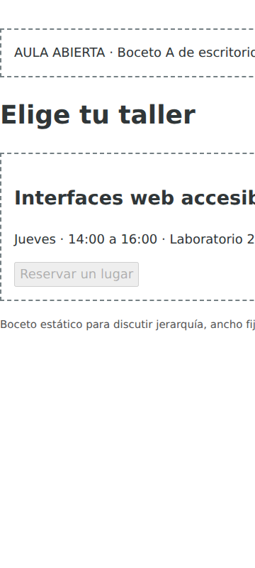

# Diagnóstico del boceto A

**Proyecto:** Aula Abierta. **Repositorio:** https://github.com/william-martinez5101/IHC_APE5  
**Archivo:** `prototipos/prototipo-A.html`. **Viewport:** 360 × 800 px. **Zoom:** 100 %.

## Hallazgo

El cuerpo tiene un ancho fijo de `960px`; la cuadrícula usa `580px 360px` con una separación de `20px`. El documento medido ocupa 960 px dentro de un viewport de 360 px. La diferencia es **600 px de desborde horizontal**.

El panel «Mi reserva» queda a la derecha del primer ancho visible. La persona necesita desplazarse horizontalmente para consultar el estado. Parte del título y de los datos también se extiende fuera de la vista móvil. El botón del boceto está deshabilitado: A sirve para diagnosticar la distribución, no para probar una reserva completa.

## Transformación de la versión B

1. Eliminar el ancho fijo y limitar el contenedor al espacio disponible.
2. Mantener oferta y estado en una columna base para móvil.
3. Activar dos columnas `3fr 2fr` desde `@media (min-width: 48rem)`.
4. Conservar en HTML la secuencia taller, datos, acción y reserva; no reordenar con CSS.
5. Mostrar confirmación/cancelación textual y dirigir el foco al control válido.

En B el ancho del documento coincide con los anchos probados (320, 360, 767, 768 y 1366 px). El panel permanece en el flujo vertical en móvil. Puede requerir desplazamiento vertical; la ausencia de desborde horizontal no demuestra por sí sola que una persona entienda la confirmación. Esta cuestión sustenta la hipótesis de Fase 2.

Las mediciones y el navegador están identificados en [resultados/pruebas.md](../resultados/pruebas.md). La implementación se encuentra en [src/index.html](../src/index.html).
